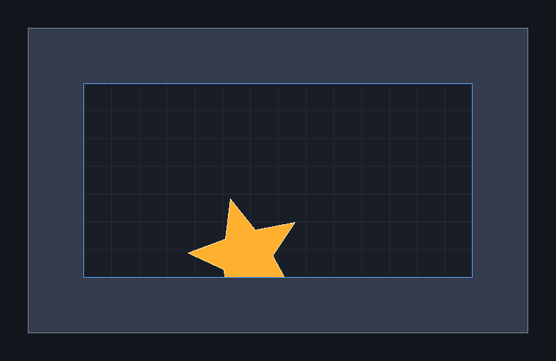
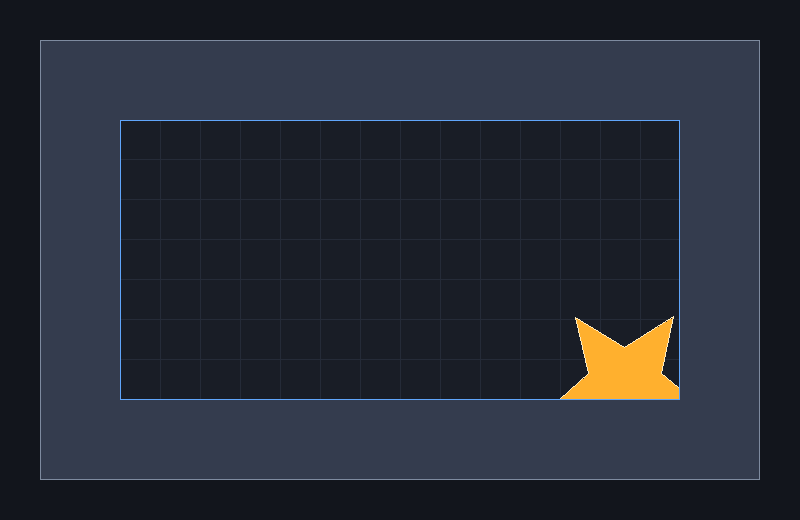

# Rasterization, Symmetry, Clipping & Filling

A small software rasterizer in pure Python. A five-pointed star drifts and spins inside a picture frame, and only the part of it inside the frame's opening (the clipping window) is drawn. Every pixel on screen comes from four classic algorithms written from scratch. No `ImageDraw`, OpenCV, `pygame.draw` or geometry libraries are used.

<p align="center">
  
</p>

This is Homework 2 of the Computer Graphics course at Amirkabir University of Technology (Tehran Polytechnic), fall 2026.

## What's implemented

All the work is in [`CG_HW02_Starter/rasterize.py`](CG_HW02_Starter/rasterize.py):

| Function | Algorithm | Role in the scene |
|---|---|---|
| `make_star_vertices` | 5-fold rotational symmetry | Builds one outer/inner vertex pair and repeats it every 72° to get the 10 vertices |
| `draw_line_bresenham` | Bresenham (integer only) | Draws the frame, the window, the grid and the visible star edges, in all 8 octants |
| `clip_line_cohen_sutherland` | Cohen–Sutherland | Clips each star edge to the window before it's drawn |
| `fill_polygon_scanline` | Scan-line with ET / AET | Fills the concave star (even-odd rule) and cuts every span to the window |
| `fill_polygon_aa` *(bonus)* | k×k supersampling | Anti-aliased fill: coverage → alpha → `α·C_shape + (1−α)·C_old` |

### Render pipeline

```
make_star_vertices ──► 10 edges ──► clip_line_cohen_sutherland ──► round ──► draw_line_bresenham   (outline)
        │
        └────────────► polygon ──► fill_polygon_scanline(img, polygon, color, window)            (fill)
                                    spans limited to [xmin, xmax], rows to [ymin, ymax]
```

The outline is clipped first and drawn after. The fill uses the original, unclipped polygon and limits each span to the window, so no clipped polygon is ever built.

## Results

<p align="center">
  <br>
  <sub>Frame at t = 8.2 s: the star crosses the bottom-right corner of the window and nothing spills onto the frame.</sub>
</p>

<p align="center">
  <br>
  <sub>6× zoom of that corner: plain scan-line (left) vs. 4×4 supersampling (right).</sub>
</p>

### Anti-aliasing quality vs. speed

| k | samples / pixel | ms / frame | error vs. k = 16 |
|---|---|---|---|
| 1 | 1 | 4.3 | 0.445 |
| 2 | 4 | 8.4 | 0.154 |
| 4 | 16 | 9.5 | 0.052 |
| 8 | 64 | 13.8 | 0.017 |

k = 4 is the sweet spot: edges look almost as smooth as k = 8, and it still renders at over 100 fps.

### Tests

```
python selfcheck.py      ->  422 / 422 checks passed
python selfcheck.py aa   ->    8 /   8 checks passed
```

## Getting started

Requires Python 3.10+ (pygame wheels may not be available yet for the newest Python, so 3.13 is a safe choice).

```bash
python -m venv venv
venv\Scripts\activate          # Windows
# source venv/bin/activate     # Linux / macOS
pip install numpy pillow pygame

cd CG_HW02_Starter
python screensaver.py
```

### Commands

| Command | What it does |
|---|---|
| `python screensaver.py` | Live animated scene |
| `python screensaver.py --export` | Saves `frame_noaa.png` and `frame_aa.png` (t = 8.2 s) |
| `python screensaver.py --export --t 8.2 --crop 630 112 64 40 --crop-zoom 6` | Also saves zoomed crops |
| `python screensaver.py --bench` | Timing and error table for k = 1 … 16 |
| `python screensaver.py --gif demo.gif --seconds 8` | Renders an animated GIF |
| `python selfcheck.py [star\|bresenham\|clip\|fill\|frames\|aa]` | Automated tests |

**Live-window keys:** `W` wireframe · `Space` pause · `←` `→` step while paused · `A` anti-aliasing on/off · `K` change k · `S` screenshot · `Esc` quit

## Conventions

- Geometry is **y-up**, as in the lecture slides. Pixel `(i, j)` is the lattice point `(i, j)`, and `(0, 0)` is the bottom-left pixel.
- The image is a NumPy `(H, W, 3)` `uint8` array. Only `put_pixel` and `fill_span` convert `y` to an array row.
- The clipping window is closed: its boundary counts as inside. The scene is 800 × 520, and the window is `(120, 120, 679, 399)`.

## Project layout

```
.
├── CG_HW02_Starter/
│   ├── rasterize.py      # my implementation
│   ├── scene.py          # scene + render pipeline          (provided)
│   ├── screensaver.py    # live viewer / export / benchmark (provided)
│   ├── selfcheck.py      # automated tests                  (provided)
│   ├── support.py        # pixel helpers                    (provided)
│   └── golden/           # reference data for the tests     (provided)
├── report/               # report (Persian) and exported frames
├── assets/               # images used in this README
└── docs/                 # assignment text and lecture notes
```

## Author

**Bardia Sabbagh**
